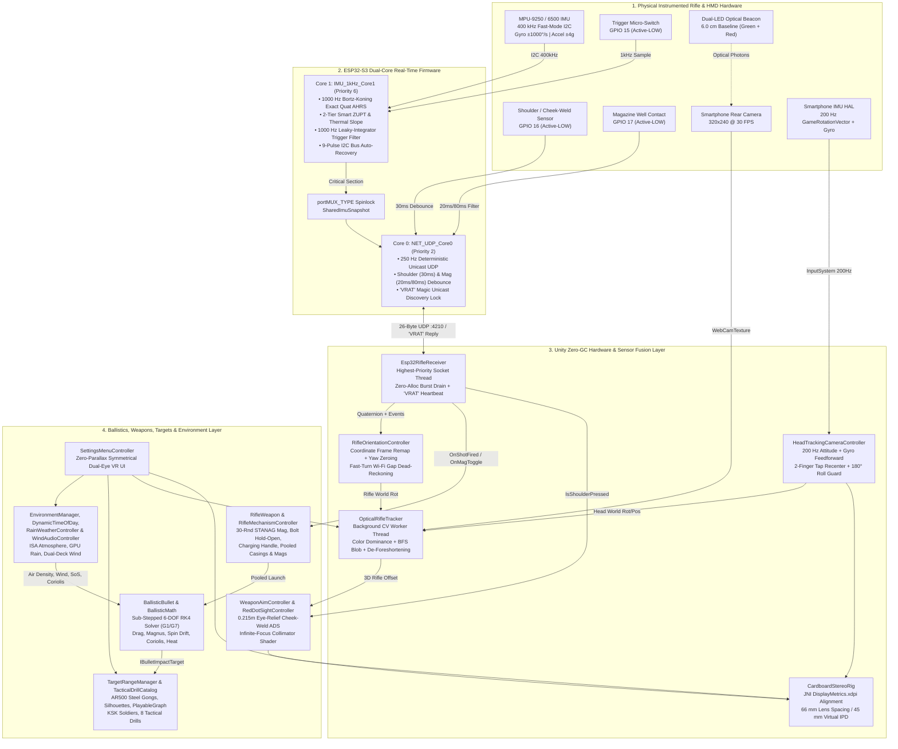
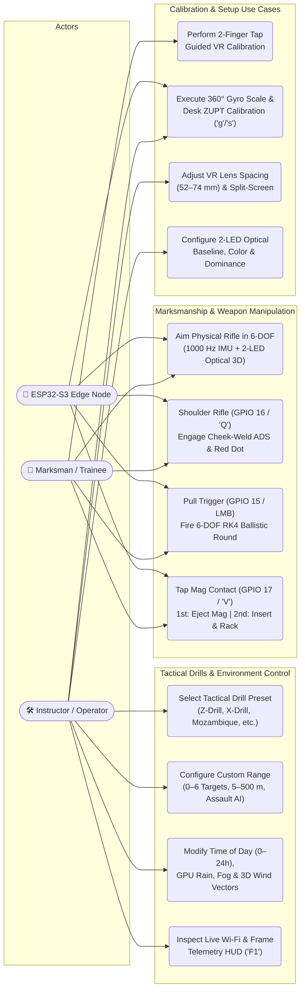
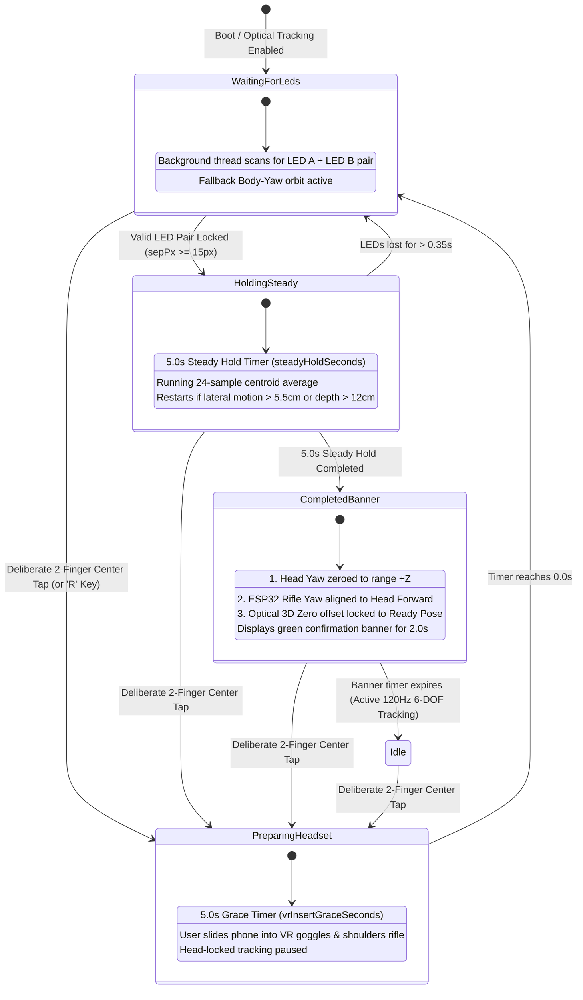
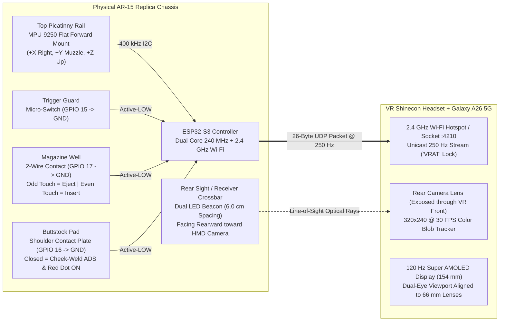
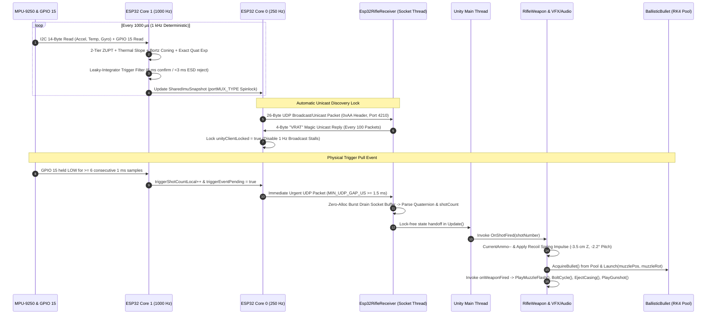
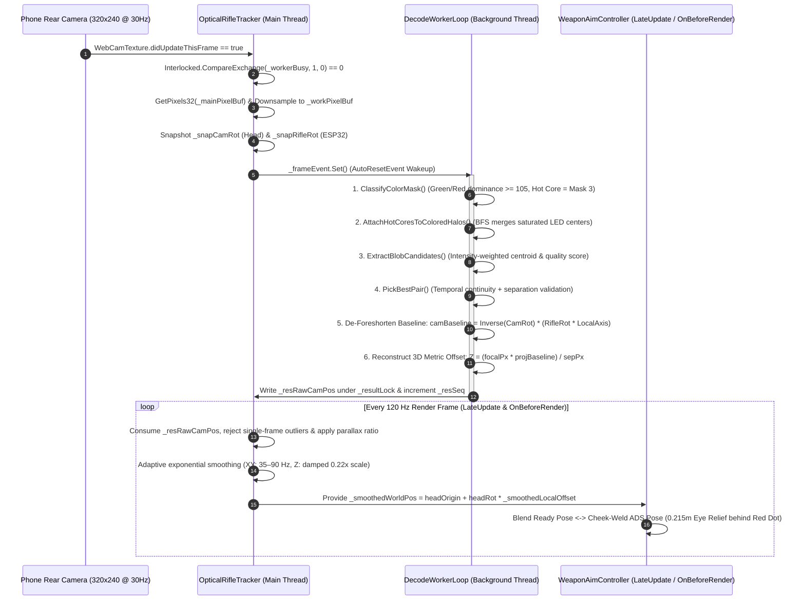
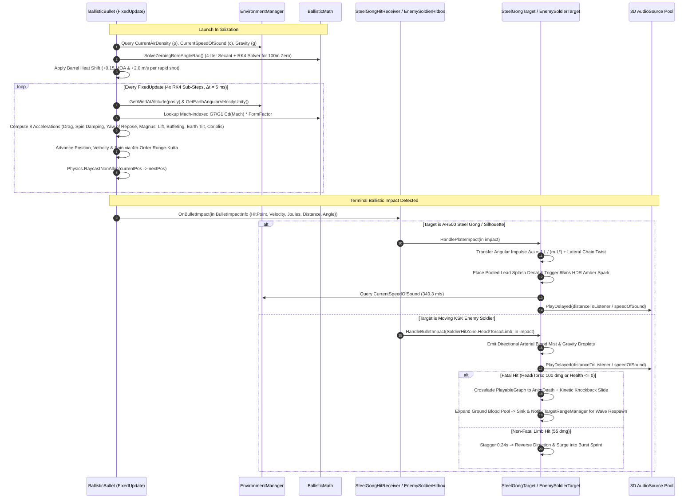
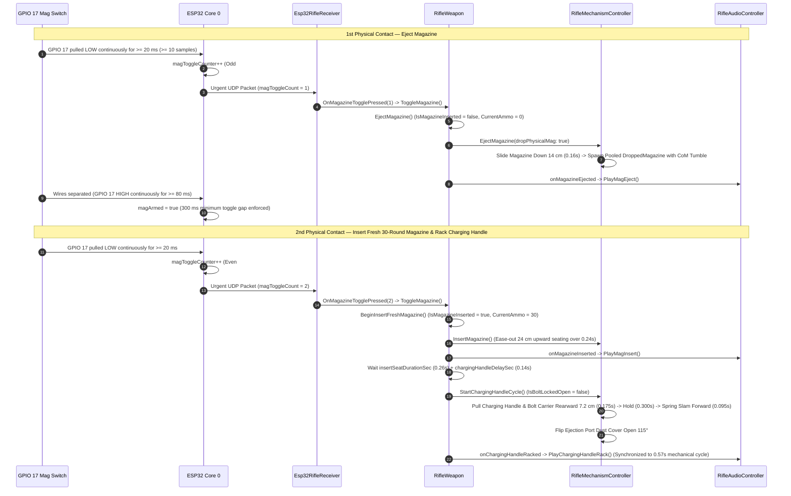

# VRAtisSimulasyonu — Hardware-in-the-Loop (HIL) Mobile VR & Tactical Ballistics Simulation Platform

[-black?logo=unity)](ProjectSettings/ProjectVersion.txt)
[-red?logo=espressif)](ESP32/VRAtisRifle_ESP32/VRAtisRifle_ESP32.ino)
[%20%7C%20Windows%20PC-blue?logo=android)](Assets/Editor/AndroidBuildTool.cs)
[-emerald)](Assets/Scripts/Ballistics/BallisticBullet.cs)

---

## Table of Contents

1. [Executive Engineering Summary](#1-executive-engineering-summary)
2. [System Architecture & High-Level Topology](#2-system-architecture--high-level-topology)
3. [User Interaction, Use Case & State Diagrams](#3-user-interaction-use-case--state-diagrams)
4. [Hardware Architecture & Electronic Schematics](#4-hardware-architecture--electronic-schematics)
5. [Embedded Firmware Engineering (ESP32-S3 Dual-Core RTOS)](#5-embedded-firmware-engineering-esp32-s3-dual-core-rtos)
6. [Software Architecture & Object-Oriented Design Patterns](#6-software-architecture--object-oriented-design-patterns)
7. [End-to-End Sequence Diagrams](#7-end-to-end-sequence-diagrams)
8. [Mathematical & Physical Subsystems](#8-mathematical--physical-subsystems)
9. [Custom HLSL Shader & Rendering Pipeline](#9-custom-hlsl-shader--rendering-pipeline)
10. [Repository Structure & Module Index](#10-repository-structure--module-index)
11. [Deployment, Calibration & Operational Manual](#11-deployment-calibration--operational-manual)

---

## 1. Executive Engineering Summary

**VRAtisSimulasyonu** is an end-to-end, **Hardware-in-the-Loop (HIL) Virtual Reality Marksmanship and External/Terminal Ballistics Simulation System**. It bridges a physically instrumented AR-15 rifle replica with a 120 Hz stereoscopic mobile VR headset (or desktop workstation) to deliver zero-latency weapon manipulation, millimeter-accurate optical positional tracking, and NATO STANAG 4355-compliant 6-DOF projectile physics.

### Core Engineering Capabilities

* **Deterministic Dual-Core Embedded Telemetry (ESP32-S3 + MPU-9250/6500)**:
  * **Core 1 (1000 Hz Real-Time Loop)**: Isolated from Wi-Fi interrupts; executes 2nd-order **Bortz Coning Compensation**, trapezoidal integration, **Exact Lie-Group Quaternion Exponential** ($SO(3) \to \mathbb{H}_1$) attitude updates, a **2-Tier Smart ZUPT (Zero Angular Velocity Update)** thermal drift compensator, and a **1000 Hz leaky-integrator trigger filter**.
  * **Core 0 (250 Hz Unicast UDP Transport)**: Streams 26-byte packed binary telemetry frames (`0xAA` header) over low-latency Wi-Fi Unicast (`WIFI_PS_NONE`), dynamically locking onto the Unity client via a 4-byte `"VRAT"` magic handshake to eliminate multicast buffer stalls on mobile hotspots.
* **Hybrid 6-DOF Weapon & Head Tracking**:
  * **Orientation**: 250 Hz ESP32 quaternion stream with short-horizon angular velocity dead-reckoning across Wi-Fi micro-gaps (`>5.5 ms` during fast swings `>18°/s`) and `Application.onBeforeRender` sub-frame pose latching.
  * **3D Translation (X, Y, Z)**: Monocular computer vision tracker running on a dedicated background thread (`0 Bytes/frame` GC allocation) at $320 \times 240$ resolution. Tracks a rifle-mounted dual-LED beacon via the smartphone's rear camera and fuses ESP32 + HMD quaternions to **de-foreshorten** the physical LED baseline under arbitrary rifle pitch, yaw, and roll.
  * **HMD Tracking**: 200 Hz Android `GameRotationVector` (drift-free 6-DOF without indoor magnetometer jumps) or optional 9-DOF compass lock, fused with `AndroidGyroscope` angular velocity and automatic $180^\circ$ landscape roll inversion recovery.
* **STANAG 4355 / McCoy 6-DOF RK4 Ballistics Engine**:
  * Sub-stepped 4th-order Runge-Kutta integration ($\Delta t \approx 5\text{ ms}$) modeling Mach-indexed **G1/G7 aerodynamic drag**, **spin damping**, **yaw of repose**, **Magnus force**, **spin drift (normal lift)**, **transonic buffeting** ($\text{Mach } 0.8\text{--}1.2$), **Earth curvature gravity tilt**, **3D Coriolis & Eötvös accelerations**, **barrel thermal harmonic shift**, **raindrop deflection**, and **speed-of-sound delayed terminal acoustic feedback**.
* **True-Metric Stereoscopic VR Optics**:
  * Queries real physical screen DPI via Android JNI (`DisplayMetrics.xdpi` / `ydpi`) to compute exact screen millimeter dimensions ($154\text{ mm}$ on Galaxy A26 5G) and aligns left/right eye viewport centers directly behind the $66\text{ mm}$ physical lenses of VR Shinecon / Cardboard headsets, completely eliminating binocular divergence and double vision.

---

## 2. System Architecture & High-Level Topology

The platform is architected across four decoupled physical and logical layers:

1. **Physical Instrumented Rifle Layer (Edge Hardware)**: Captures 6-DOF inertial dynamics and tactile switch states (Trigger, Buttstock Cheek-Weld/Shoulder, Magazine Well Contact) and emits optical reference beacons.
2. **Low-Latency Wireless Transport Layer**: High-frequency 250 Hz UDP Unicast link with automatic client discovery and zero-allocation burst socket draining.
3. **Sensor Fusion & Computer Vision Layer**: Reconstructs 6-DOF world poses for both the shooter's head and the physical rifle at 120 FPS.
4. **Simulation, Ballistics, AI & URP Rendering Layer**: Drives weapon mechanics, 6-DOF RK4 projectile flight, reactive targets, dynamic alpine weather/time-of-day shaders, and symmetrical dual-eye VR UI.



---

## 3. User Interaction, Use Case & State Diagrams

### 3.1 System Actors

| Actor | Role & Responsibilities |
| :--- | :--- |
| **Marksman / Trainee (VR User)** | Wears the stereoscopic HMD, physically holds and aims the instrumented AR-15 rifle replica, operates the trigger (`GPIO 15`), shoulders the buttstock (`GPIO 16`), swaps magazines (`GPIO 17`), and triggers 2-finger tap calibration. |
| **Instructor / Operator** | Configures tactical drills (Z-Drill, Mozambique, El Presidente, etc.), target distances ($5\text{--}500\text{ m}$), weather/wind conditions, time of day, and monitors live Wi-Fi/FPS telemetry (`F1`). |
| **ESP32-S3 Rifle Controller** | Autonomous embedded edge node executing 1000 Hz inertial fusion, thermal bias learning, switch debouncing, and 250 Hz UDP streaming. |
| **Smartphone HMD Subsystem** | Provides 120 Hz stereoscopic display, 200 Hz head orientation sensing, and 30 FPS rear-camera optical LED tracking. |

### 3.2 Comprehensive Use Case & User Flow Diagram



### 3.3 Guided Optical & HMD Calibration State Machine

When the trainee performs a deliberate **2-finger tap** inside the central region of the smartphone screen ($14\%\text{--}86\%$ width/height, ignoring bezel grasps while inserting the phone into the VR headset), [`HeadTrackingCameraController`](Assets/Scripts/Hardware/HeadTrackingCameraController.cs) and [`OpticalRifleTracker`](Assets/Scripts/Hardware/OpticalRifleTracker.cs) execute a 5-stage guided calibration state machine rendered symmetrically across both VR eyes:



---

## 4. Hardware Architecture & Electronic Schematics

### 4.1 Bill of Materials (BOM) & Subsystem Specifications

| Component | Model / Part | Interface / Bus | Key Engineering Parameters |
| :--- | :--- | :--- | :--- |
| **Microcontroller Unit (MCU)** | **ESP32-S3 DevKitC-1** | Dual-Core Xtensa LX7 @ 240 MHz | Core 1: 1 kHz IMU/Trigger; Core 0: 250 Hz Wi-Fi UDP; NVS Flash storage |
| **Inertial Sensor (IMU)** | **MPU-9250** or **MPU-6500** | I2C Fast-Mode ($400\text{ kHz}$) | Addr `0x68`/`0x69`, Gyro $\pm 1000^\circ/\text{s}$ ($184\text{ Hz}$ DLPF), Accel $\pm 4g$ ($41\text{ Hz}$ DLPF) |
| **Trigger Switch** | SPST Momentary Micro-Switch | `GPIO 15` $\leftrightarrow$ `GND` | Internal pull-up (`INPUT_PULLUP`), active-LOW, 1 kHz leaky integrator ($6\text{ ms}$ confirm) |
| **Shoulder / ADS Contact** | Conductive Buttstock Switch | `GPIO 16` $\leftrightarrow$ `GND` | Internal pull-up (`INPUT_PULLUP`), active-LOW, $30\text{ ms}$ continuous state debounce |
| **Magazine Contact Switch** | Magwell Leaf / Reed Switch | `GPIO 17` $\leftrightarrow$ `GND` | Internal pull-up (`INPUT_PULLUP`), active-LOW, $20\text{ ms}$ confirm / $80\text{ ms}$ release / $300\text{ ms}$ gap |
| **Optical Tracking Beacon** | 2x High-Output Diffused LEDs | $3.3\text{V}$ / $5\text{V}$ Rail via Resistors | Default: **Green ($525\text{ nm}$) + Red ($625\text{ nm}$)** on $6.0\text{ cm}$ horizontal crossbar facing shooter |
| **VR Headset Display & Host** | **Samsung Galaxy A26 5G** (or PC) | 2.4 GHz Wi-Fi Hotspot / LAN | $120\text{ Hz}$ display ($154\text{ mm}$ width via `xdpi`), $320\times 240$ @ $30\text{ FPS}$ rear camera, $200\text{ Hz}$ IMU |
| **Stereoscopic HMD Enclosure** | **VR Shinecon / Cardboard** | Optical Fresnel / Aspheric Lenses | $66\text{ mm}$ physical inter-lens spacing (`DefaultLensSpacingMm`), $45\text{ mm}$ virtual IPD, $68^\circ$ VFOV |

### 4.2 Pinout & Electrical Signal Mapping Table

| ESP32-S3 Pin | Signal Name | Connected Peripheral Pin | Electrical Configuration | Sampling / Filtering Regime |
| :---: | :--- | :--- | :--- | :--- |
| **`3V3`** | `VCC_3V3` | MPU-9250/6500 `VCC` (+ LED Anodes) | Regulated $3.3\text{ V}$ DC Output | Continuous power rail |
| **`GND`** | `GND` | MPU `GND`, Switches Common, LED Cathodes | Common System Ground | Star-ground reference |
| **`GPIO 8`** | `I2C_SDA` | MPU-9250/6500 `SDA` | Open-Drain + $4.7\text{ k}\Omega$ Pull-Up | $400\text{ kHz}$ Fast-Mode I2C + 9-Pulse Bus Clear |
| **`GPIO 9`** | `I2C_SCL` | MPU-9250/6500 `SCL` | Open-Drain + $4.7\text{ k}\Omega$ Pull-Up | $400\text{ kHz}$ Fast-Mode I2C Clock |
| **`GPIO 15`** | `TRIGGER_PIN` | Trigger Micro-Switch (NO terminal) | `INPUT_PULLUP` (Active-LOW to `GND`) | Core 1 @ $1000\text{ Hz}$ ($6\text{ ms}$ leaky press / $15\text{ ms}$ release / $35\text{ ms}$ gap) |
| **`GPIO 16`** | `SHOULDER_PIN` | Buttstock Cheek/Shoulder Switch (NO) | `INPUT_PULLUP` (Active-LOW to `GND`) | Core 0 @ $1000\text{ Hz}$ ($30\text{ ms}$ continuous state debounce) |
| **`GPIO 17`** | `MAG_PIN` | Magazine Well Contact Switch (NO) | `INPUT_PULLUP` (Active-LOW to `GND`) | Core 0 @ $1000\text{ Hz}$ ($20\text{ ms}$ confirm / $80\text{ ms}$ release / $300\text{ ms}$ toggle gap) |

### 4.3 Detailed Electronic Circuit Schematic (ASCII Engineering Diagram)

```text
=========================================================================================================
                   VRAtisSimulasyonu — INSTRUMENTED AR-15 RIFLE ELECTRONIC SCHEMATIC
=========================================================================================================

   +5V USB / Li-Po Battery Pack (Power Bank mounted on Stock)
       │
       ▼
  ┌───────────────────────────────────────────────┐
  │            ESP32-S3-WROOM-1 / DevKitC         │
  │                                               │
  │  [3V3] ──────────────┬────────────────────────┼──────► +3.3V Rail
  │                      │                        │
  │                      ├───[4.7kΩ]───┐          │      ┌───────────────────────────────────────┐
  │                      └───[4.7kΩ]─┐ │          │      │     MPU-9250 / MPU-6500 6-DOF IMU     │
  │                                  │ │          │      │  (Mounted Flat on Top Picatinny Rail) │
  │                                  │ │          │      │  Axes: +X = Right, +Y = Barrel, +Z=Up │
  │                                  │ │          │      │                                       │
  │  [GPIO 8  / I2C_SDA] ────────────┴─┼──────────┼─────►│ SDA                              VCC  │◄── +3.3V
  │  [GPIO 9  / I2C_SCL] ──────────────┴──────────┼─────►│ SCL                              GND  │──┐
  │                                               │      │ AD0 ──► GND (I2C Addr = 0x68)         │  │
  │                                               │      └───────────────────────────────────────┘  │
  │                                               │                                                 │
  │                                               │      ┌───────────────────────────────────────┐  │
  │                                               │      │   TACTILE RIFLE CONTROLS (Active-LOW) │  │
  │                                               │      │                                       │  │
  │  [GPIO 15 / TRIGGER_PIN]  (Internal Pull-Up) ─┼─────►│ ──/ ── Trigger Micro-Switch           │──┤
  │                                               │      │        (Core 1: 1kHz, 6ms Leaky Int.) │  │
  │                                               │      │                                       │  │
  │  [GPIO 16 / SHOULDER_PIN] (Internal Pull-Up) ─┼─────►│ ──/ ── Buttstock Shoulder Sensor      │──┤
  │                                               │      │        (Core 0: 30ms Debounce -> ADS) │  │
  │                                               │      │                                       │  │
  │  [GPIO 17 / MAG_PIN]      (Internal Pull-Up) ─┼─────►│ ──/ ── Magazine Well Contact Switch   │──┤
  │                                               │      │        (Core 0: 20ms Confirm -> 'V')  │  │
  │                                               │      └───────────────────────────────────────┘  │
  │                                               │                                                 │
  │  [GND] ───────────────────────────────────────┼─────────────────────────────────────────────────┴──► GND
  └───────────────────────────────────────────────┘

  ┌─────────────────────────────────────────────────────────────────────────────────────────────────┐
  │                  2-LED OPTICAL TRACKING BEACON (Mounted on Rifle Facing Shooter)                │
  │                                                                                                 │
  │   +3.3V ───┬───[ 68Ω ]───►│◄─── (LED A: High-Intensity Diffused GREEN 525nm) ───┐               │
  │            │              └───◄────── Physical Center-to-Center ──────►───┐     ├───► GND       │
  │            └───[ 100Ω ]──►│◄─── (LED B: High-Intensity Diffused RED   625nm) ───┘               │
  │                                       Baseline B = 6.0 cm (0.060 m)                             │
  └─────────────────────────────────────────────────────────────────────────────────────────────────┘
```

### 4.4 Hardware Block & Physical Mounting Topology



---

## 5. Embedded Firmware Engineering (ESP32-S3 Dual-Core RTOS)

The firmware in [`ESP32/VRAtisRifle_ESP32/VRAtisRifle_ESP32.ino`](ESP32/VRAtisRifle_ESP32/VRAtisRifle_ESP32.ino) is engineered to solve three classic embedded VR challenges: **Wi-Fi interrupt jitter corrupting gyro integration**, **indoor magnetic anomalies causing 9-DOF yaw drift**, and **ESD/crosstalk glitches causing false trigger or magazine events**.

### 5.1 Dual-Core FreeRTOS Task Partitioning

| Attribute | Core 1 Task (`imuTaskFn`) | Core 0 Task (`netTaskFn`) |
| :--- | :--- | :--- |
| **FreeRTOS Task Name** | `"IMU_1kHz_Core1"` | `"NET_UDP_Core0"` |
| **Pinned CPU Core** | **Core 1** (Isolated Application Core) | **Core 0** (Protocol / Wi-Fi Radio Core) |
| **RTOS Priority** | **Priority 6** (Highest Real-Time) | **Priority 2** (Network / Telemetry) |
| **Execution Frequency** | **$1000\text{ Hz}$** ($\Delta t = 1000\text{ }\mu\text{s}$ via `vTaskDelayUntil`) | **$1000\text{ Hz}$ Poll / $250\text{ Hz}$ UDP TX** ($\Delta t_{\text{UDP}} = 4000\text{ }\mu\text{s}$) |
| **Primary Responsibilities** | • $400\text{ kHz}$ I2C 14-byte burst read (`0x3B`)<br/>• 2nd-Order Bortz Coning + Exact Quaternion Exp<br/>• 2-Tier Smart ZUPT & Thermal Slope compensation<br/>• $1000\text{ Hz}$ Leaky-Integrator Trigger sampling<br/>• Self-healing 9-pulse I2C bus recovery | • $30\text{ ms}$ Shoulder & $20\text{ ms}/80\text{ ms}$ Magazine debounce<br/>• Immediate urgent event UDP transmission ($1.5\text{ ms}$ min gap)<br/>• `"VRAT"` Unicast client discovery & broadcast suppression<br/>• Non-blocking USB-CDC Serial command & $1\text{ Hz}$ telemetry |

### 5.2 Exact Lie-Group Quaternion AHRS with Bortz Coning Compensation

Standard first-order Euler quaternion integration ($\mathbf{q} \leftarrow \mathbf{q} + \frac{1}{2}\mathbf{q}\otimes\boldsymbol{\omega}\Delta t$) suffers from non-commutative coning drift under high-speed multi-axis rifle swings and violates unit-norm constraints. Core 1 implements an exact 2nd-order Lie-group integrator at $1000\text{ Hz}$:

1. **Trapezoidal + 2nd-Order Bortz Coning Rotation Vector ($\Delta\boldsymbol{\theta}$)**:
   $$\Delta\boldsymbol{\theta}_k = \frac{1}{2}\left(\boldsymbol{\omega}_{k-1} + \boldsymbol{\omega}_k\right)\Delta t + \frac{\Delta t^2}{12}\left(\boldsymbol{\omega}_{k-1} \times \boldsymbol{\omega}_k\right)$$
2. **Exact Quaternion Exponential Map ($\exp(\frac{1}{2}\Delta\boldsymbol{\theta}_k)$)**:
   $$\Delta\mathbf{q}_k = \begin{bmatrix} \cos\left(\frac{\|\Delta\boldsymbol{\theta}_k\|}{2}\right) \\ \Delta\boldsymbol{\theta}_k \frac{\sin\left(\|\Delta\boldsymbol{\theta}_k\|/2\right)}{\|\Delta\boldsymbol{\theta}_k\|} \end{bmatrix}, \quad \mathbf{q}_k = \mathbf{q}_{k-1} \otimes \Delta\mathbf{q}_k$$
   *(For small angles $\|\Delta\boldsymbol{\theta}_k\|^2 \le 10^{-10}$, a 2nd-order Taylor expansion $\Delta q_w = 1 - \frac{1}{8}\|\Delta\boldsymbol{\theta}_k\|^2$ avoids division by zero).*
3. **Dynamic Acceleration-Gated Gravity Gradient Correction**:
   * Whenever angular rate exceeds `MOVE_GYRO_GATE_RAD_S` ($0.14\text{ rad/s} \approx 8^\circ/\text{s}$) or linear acceleration deviates from $1g$ (`|accMag - 1g| > 0.035g`), the gravity gradient gain is gated off ($\beta = 0$).
   * This guarantees **zero pitch/roll-into-yaw cross-coupling** during rapid target transitions while gently locking pitch and roll to true gravity ($\beta = 0.012$) after a $120\text{ ms}$ post-motion vibration settling window.

### 5.3 Two-Tier Smart ZUPT & Persistent NVS Thermal Compensation

Pure 6-DOF integration eliminates indoor magnetometer jumps entirely, but requires sub-0.01°/s gyroscope bias stability. The firmware implements a **Two-Tier Zero Angular Velocity Update (ZUPT)** combined with linear thermal slope modeling:

$$\mathbf{b}_{\text{eff}}(T) = \mathbf{b}_{\text{base}}(T_{\text{ref}}) + \mathbf{k}_T \cdot \left(T_{\text{smooth}} - T_{\text{ref}}\right)$$

* **Tier 2 — Rigid Desk / Supported Rest Lock (`6DOF-SABIT`, `zuptTier = 2`)**:
  * **Trigger Condition**: $1500$ consecutive samples ($1.5\text{ s}$) with acceleration delta $< 0.006g$ and gyro deviation from anchor $< 0.22^\circ/\text{s}$.
  * **Action**: Updates live bias offset ($\alpha = 0.008$), hard-zeroes residual rates $< 0.12^\circ/\text{s}$, and when die temperature changes by $\ge 3.0^\circ\text{C}$ over $\ge 4.0\text{ s}$ of rest, automatically learns and persists the per-axis thermal slope $\mathbf{k}_T \in [-8.20, +8.20]\text{ LSB}/^\circ\text{C}$ into ESP32 NVS Flash (`Preferences` namespace `"vratis_gyro"`).
* **Tier 1 — In-Hand Aiming Ultra-Guarded Thermal Learner (`6DOF-NISAN`, `zuptTier = 1`)**:
  * **Trigger Condition**: $2500$ consecutive samples ($2.5\text{ s}$) of steady aiming where a $0.28\text{ Hz}$ low-pass filter ($\alpha_{\text{LP}} = 0.0018$, filtering out human pulse and hand tremor) remains $< 0.30^\circ/\text{s}$ and instantaneous tremor stays $< 2.50^\circ/\text{s}$.
  * **Action**: Applies an ultra-gentle thermal bias correction ($\alpha = 0.00015$, time constant $\sim 6.7\text{ s}$, clamped within $\pm 0.45^\circ/\text{s}$ of the clean boot baseline) so deliberate slow target tracking is **never** mistaken for sensor bias.

### 5.4 26-Byte Packed Binary UDP Telemetry Protocol

Every $4\text{ ms}$ ($250\text{ Hz}$)—or immediately within $1.5\text{ ms}$ upon a confirmed trigger, shoulder, or magazine event—Core 0 transmits the packed little-endian `RifleQuaternionPacket` to UDP Port `4210`:

```text
 0                   1                   2                   3
 0 1 2 3 4 5 6 7 8 9 0 1 2 3 4 5 6 7 8 9 0 1 2 3 4 5 6 7 8 9 0 1
+-+-+-+-+-+-+-+-+-+-+-+-+-+-+-+-+-+-+-+-+-+-+-+-+-+-+-+-+-+-+-+-+
| Header (0xAA) |                 qw (float32)                  | Bytes 0..4
+-+-+-+-+-+-+-+-+-+-+-+-+-+-+-+-+-+-+-+-+-+-+-+-+-+-+-+-+-+-+-+-+
|         qw (cont.)            |          qx (float32)         | Bytes 4..8
+-+-+-+-+-+-+-+-+-+-+-+-+-+-+-+-+-+-+-+-+-+-+-+-+-+-+-+-+-+-+-+-+
|         qx (cont.)            |          qy (float32)         | Bytes 8..12
+-+-+-+-+-+-+-+-+-+-+-+-+-+-+-+-+-+-+-+-+-+-+-+-+-+-+-+-+-+-+-+-+
|         qy (cont.)            |          qz (float32)         | Bytes 12..16
+-+-+-+-+-+-+-+-+-+-+-+-+-+-+-+-+-+-+-+-+-+-+-+-+-+-+-+-+-+-+-+-+
|   qz (cont.)  | triggerState  |       shotCount (uint32)      | Bytes 16..20
+-+-+-+-+-+-+-+-+-+-+-+-+-+-+-+-+-+-+-+-+-+-+-+-+-+-+-+-+-+-+-+-+
|      shotCount (cont.)        | shoulderState |   magState    | Bytes 20..23
+-+-+-+-+-+-+-+-+-+-+-+-+-+-+-+-+-+-+-+-+-+-+-+-+-+-+-+-+-+-+-+-+
|    magToggleCount (uint16)    |                                 Bytes 24..25 (Total: 26 Bytes)
+-+-+-+-+-+-+-+-+-+-+-+-+-+-+-+-+
```

| Byte Offset | C/C++ Type | Field Name | Description & Semantics |
| :---: | :---: | :--- | :--- |
| **`0`** | `uint8_t` | `header` | Sync magic byte (`0xAA`). Packets without `0xAA` or $< 22\text{ bytes}$ are dropped. |
| **`1..4`** | `float` | `qw` | Unit quaternion scalar component ($w$, IEEE-754 little-endian). |
| **`5..8`** | `float` | `qx` | Unit quaternion $x$ vector component. |
| **`9..12`** | `float` | `qy` | Unit quaternion $y$ vector component. |
| **`13..16`** | `float` | `qz` | Unit quaternion $z$ vector component. |
| **`17`** | `uint8_t` | `triggerState` | `1` = Trigger currently depressed (`GPIO 15` LOW), `0` = Released. |
| **`18..21`** | `uint32_t` | `shotCount` | Monotonic confirmed trigger press counter (drives `OnShotFired` delta events). |
| **`22`** | `uint8_t` | `shoulderState` | `1` = Rifle shouldered (`GPIO 16` LOW for $\ge 30\text{ ms}$ $\to$ Cheek-Weld ADS & Red Dot ON), `0` = Ready stance. |
| **`23`** | `uint8_t` | `magState` | `1` = Magazine switch currently in contact (`GPIO 17` LOW), `0` = Open. |
| **`24..25`** | `uint16_t` | `magToggleCount` | Monotonic confirmed magazine contact counter (`1st` odd = Eject Mag, `2nd` even = Insert Mag & Rack Charging Handle). |

---

## 6. Software Architecture & Object-Oriented Design Patterns

The Unity C# codebase (`VRAtis.*` namespaces) is strictly engineered around **Zero-Garbage-Collection (Zero-GC)** runtime execution and clean separation of concerns to sustain locked $120\text{ FPS}$ frame times on mobile ARM64 processors.

### 6.1 Catalog of Applied Design Patterns

| Design Pattern | Implementing Classes | Engineering Problem Solved |
| :--- | :--- | :--- |
| **1. Object Pool Pattern (Prewarmed Zero-GC Queues & Ring Buffers)** | • [`RifleWeapon`](Assets/Scripts/Weapons/RifleWeapon.cs) (`Queue<BallisticBullet>`, size 16)<br/>• [`RifleMechanismController`](Assets/Scripts/Weapons/RifleMechanismController.cs) (`Queue<EjectedCasing>` 16, `Queue<DroppedMagazine>` 4)<br/>• [`RifleAudioController`](Assets/Scripts/Weapons/RifleAudioController.cs) (Polyphonic `AudioSource[]` pools)<br/>• [`SteelGongTarget`](Assets/Scripts/Targets/SteelGongTarget.cs) & [`TestTargetFeedback`](Assets/Scripts/Targets/TestTargetFeedback.cs) (`Transform[]` ring buffers)<br/>• [`TargetRangeManager`](Assets/Scripts/Targets/TargetRangeManager.cs) (Gong, Silhouette & KSK Soldier pools) | Eliminates `Instantiate()` / `Destroy()` heap allocations and garbage-collector frame spikes during rapid 30-round firing, brass ejection, lead splash marking, and tactical drill switching. |
| **2. Producer-Consumer & Double-Buffered Snapshot Pattern** | • [`VRAtisRifle_ESP32.ino`](ESP32/VRAtisRifle_ESP32/VRAtisRifle_ESP32.ino) (`SharedImuSnapshot` + `portMUX_TYPE`)<br/>• [`Esp32RifleReceiver`](Assets/Scripts/Hardware/Esp32RifleReceiver.cs) (`ReceiveLoop` thread + `_stateLock` + burst drain)<br/>• [`OpticalRifleTracker`](Assets/Scripts/Hardware/OpticalRifleTracker.cs) (`DecodeWorkerLoop` thread + `AutoResetEvent` + `Interlocked.CompareExchange`) | Decouples asynchronous I/O and heavy $320\times 240$ pixel BFS computer vision from Unity's $120\text{ Hz}$ rendering loop with zero heap allocations per packet/frame. |
| **3. Observer / Publish-Subscribe Pattern** | • [`Esp32RifleReceiver`](Assets/Scripts/Hardware/Esp32RifleReceiver.cs) (`OnShotFired`, `OnMagazineTogglePressed`)<br/>• [`RifleWeapon`](Assets/Scripts/Weapons/RifleWeapon.cs) (`UnityEvent`: `onWeaponFired`, `onMagazineEjected`, `onMagazineInserted`, `onChargingHandleRacked`)<br/>• [`TargetRangeManager`](Assets/Scripts/Targets/TargetRangeManager.cs) (`OnDrillConfigChanged`) | Decouples hardware edge triggers and weapon state transitions from visual muzzle flash, mechanical bolt/magazine animations, and 3D spatialized audio playback. |
| **4. Strategy & Polymorphic Target Interface Pattern** | • [`IBulletImpactTarget`](Assets/Scripts/Ballistics/IBulletImpactTarget.cs) (`OnBulletImpact(in BulletImpactInfo)`)<br/>• [`SteelGongHitReceiver`](Assets/Scripts/Targets/SteelGongHitReceiver.cs), [`EnemySoldierHitbox`](Assets/Scripts/Targets/EnemySoldierHitbox.cs), [`TestTargetFeedback`](Assets/Scripts/Targets/TestTargetFeedback.cs)<br/>• [`BallisticMath`](Assets/Scripts/Ballistics/BallisticMath.cs) (`DragModel.G1` vs `DragModel.G7`, `AmmoPreset`) | Allows [`BallisticBullet`](Assets/Scripts/Ballistics/BallisticBullet.cs) to deliver rich terminal ballistic data (`HitPoint`, `ImpactVelocity`, `KineticEnergyJoules`, `ImpactAngleDeg`) to any target type without type-switching or boxing (`in` struct pass-by-reference). |
| **5. Finite State Machine (FSM) Pattern** | • [`EnemySoldierTarget`](Assets/Scripts/Targets/EnemySoldierTarget.cs) (`AiState`: `IdleScan`, `PatrolWalk`, `TacticalSprint`, `Dead`)<br/>• [`RifleWeapon`](Assets/Scripts/Weapons/RifleWeapon.cs) (`ReloadPhase`: `None`, `EjectWait`, `Inserting`, `ChargingHandleDelay`, `ChargingHandleCycle`)<br/>• [`OpticalRifleTracker`](Assets/Scripts/Hardware/OpticalRifleTracker.cs) (`CalibrationPhase`) | Governs complex multi-stage temporal behaviors: KSK soldier evasive feints and assault charges, synchronized magazine swap + charging handle racking, and guided 2-finger VR calibration. |
| **6. Singleton & Global GPU Blackboard Pattern** | • [`EnvironmentManager`](Assets/Scripts/Ballistics/EnvironmentManager.cs) (`EnvironmentManager.Instance`)<br/>• [`DynamicTimeOfDay`](Assets/Scripts/Environment/DynamicTimeOfDay.cs) (`Shader.SetGlobal*` for `_VRAtisSky*` & `_GlobalWindVector`) | Centralizes ISA atmospheric physics (air density, speed of sound, wind altitude gradient, Coriolis vector) and broadcasts lighting/wind state to all custom URP shaders without dirtying `.mat` assets on disk. |
| **7. Symmetrical Dual-View MVP Pattern** | • [`SettingsMenuController`](Assets/Scripts/UI/SettingsMenuController.cs) (`UiView` `_primaryView` + `_mirrorView` bound to `CardboardStereoRig` eye viewports) | Mirrors the entire interactive Settings UI, Optical Calibration Banner, and Tactical Drill Subtitle Coach inside both left and right eye viewports at zero parallax so VR lenses fuse UI elements cleanly. |
| **8. Flyweight Pattern** | • [`RifleVisualEffects`](Assets/Scripts/Weapons/RifleVisualEffects.cs), [`RedDotSightController`](Assets/Scripts/Weapons/RedDotSightController.cs), [`RainWeatherController`](Assets/Scripts/Environment/RainWeatherController.cs) (`MaterialPropertyBlock` + shared static procedural textures) | Updates per-instance shader uniforms (`_ReticlePower`, `_Intensity`, `_TileIndex`, `_RainIntensity`) without cloning materials or breaking SRP Batcher compatibility. |

### 6.2 Core Architecture UML Class Diagram

```mermaid
classDiagram
    direction TB

    class Esp32RifleReceiver {
        +byte PacketHeader = 0xAA
        +Quaternion RawImuQuaternion
        +bool IsTriggerPressed
        +bool IsShoulderPressed
        +bool IsMagContactPressed
        +uint TotalShotCount
        +uint TotalMagToggleCount
        +float PacketRateHz
        +event Action~uint~ OnShotFired
        +event Action~uint~ OnMagazineTogglePressed
        +StartReceiver()
        +StopReceiver()
        -ReceiveLoop()
    }

    class RifleOrientationController {
        +SensorMountPreset mountPreset
        +float EstimatedAngularSpeedDegPerSec
        +RecenterToHeadForward()
        +SoftAlignToHeadForward(float blend01)
        +ApplyOpticalYawCorrection(float deltaYawDeg)
        -ConvertImuToUnity(Quaternion imuQ) Quaternion
        -ApplyFastTurnWifiGapBridge(Quaternion rot) Quaternion
    }

    class OpticalRifleTracker {
        +LedTargetMode CurrentTargetMode
        +BaselineAxis CurrentBaselineAxis
        +CalibrationPhase CurrentCalibrationPhase
        +float LedSpacingMeters
        +bool IsActivelyTrackingPosition
        +RecenterOpticalZero(bool startGuidedCountdown)
        +TryGetSmoothedWorldPos(out Vector3 worldPos) bool
        -DecodeWorkerLoop()
        -ProcessCameraFrame()
        -ReconstructCameraSpacePosition() Vector3
    }

    class HeadTrackingCameraController {
        +bool IsUsingMobileSensor
        +bool UseCompassNorthLock
        +Vector3 ReadyWorldPosition
        +Quaternion ReadyWorldRotation
        +RecenterHeadYawOnly()
        +RecenterHeadAndRifle()
        -EvaluateDeliberateTwoFingerTap() bool
        -TryReadPhoneAttitude(out Quaternion rot) bool
    }

    class CardboardStereoRig {
        +bool IsStereoSplitActive$
        +Rect LeftEyeViewportNorm$
        +Rect RightEyeViewportNorm$
        +float ActiveLensSpacingMm$
        +float DetectedPhoneWidthMm$
        +SetLensCenterSpacingMm(float spacingMm, bool persist)
        +SetDynamicFovOffset(float fovDeltaDeg)
        -MeasurePhysicalPhoneWidthMm() float
    }

    class WeaponAimController {
        +bool IsAiming
        +float AimBlend
        -float eyeReliefMeters = 0.215f
        -UpdateAimCameraPose()
    }

    class RedDotSightController {
        +bool AlwaysKeepReticleOn
        +float ReticlePower
        +SetReticlePower(float power01)
        -UpdateShaderVectors()
    }

    class RifleWeapon {
        +int CurrentAmmo
        +int MagazineCapacity = 30
        +bool IsMagazineInserted
        +bool IsBoltLockedOpen
        +bool IsReloading
        +UnityEvent onWeaponFired
        +UnityEvent onMagazineEjected
        +UnityEvent onMagazineInserted
        +UnityEvent onChargingHandleRacked
        +Fire()
        +Reload()
        +ToggleMagazine()
        +RackChargingHandle()
    }

    class RifleMechanismController {
        +bool IsChargingHandleCycling
        +float ChargingCycleTotalDuration
        +OnWeaponFired()
        +LockBoltOpenAfterCycle()
        +CycleChargingHandle()
        +EjectMagazine(bool dropPhysicalMag)
        +InsertMagazine()
    }

    class BallisticBullet {
        +Vector3 velocity
        +float flightTime
        +float distanceTraveled
        +float currentSpinRad
        +Launch(Vector3 muzzlePos, Quaternion aimRot, ...)
        -StepRk4(ref Vector3 pos, ref Vector3 vel, ref float spin, ...)
        -Calculate6DofDerivatives(...) Vector3
        -HandleTerminalBallistics(RaycastHit hit)
    }

    class IBulletImpactTarget {
        <<interface>>
        +OnBulletImpact(in BulletImpactInfo impact)
    }

    class SteelGongTarget {
        +int HitCount
        +float LastImpactDistanceMeters
        +float LastImpactEnergyJoules
        +HandlePlateImpact(in BulletImpactInfo impact)
        +HandleFrameImpact(in BulletImpactInfo impact)
        +ResetVisualState()
    }

    class EnemySoldierTarget {
        +bool IsDead
        +bool IsAssaultMode
        +float CurrentHealth
        +int KillCount
        +ConfigurePatrolZone(...)
        +HandleBulletImpact(SoldierHitZone zone, in BulletImpactInfo impact)
        +ResetSoldierState()
    }

    class TargetRangeManager {
        +TargetKind ActiveTargetKind
        +int TargetCount
        +float DistanceMeters
        +float SpacingMeters
        +ApplyTacticalDrillPreset(TacticalDrillDefinition def)
        +SetTargetKind(TargetKind kind)
        +ClearAllImpactMarksAndSwings()
    }

    class EnvironmentManager {
        +EnvironmentManager Instance$
        +float CurrentAirDensity
        +float CurrentSpeedOfSound
        +Vector3 windSpeedMS
        +bool isRaining
        +GetWindAtAltitude(float altitudeY) Vector3
        +GetEarthAngularVelocityUnity() Vector3
    }

    Esp32RifleReceiver --> RifleOrientationController : RawImuQuaternion
    Esp32RifleReceiver --> RifleWeapon : OnShotFired / OnMagazineTogglePressed
    Esp32RifleReceiver --> WeaponAimController : IsShoulderPressed
    HeadTrackingCameraController --> RifleOrientationController : RecenterToHeadForward()
    HeadTrackingCameraController --> OpticalRifleTracker : RecenterOpticalZero()
    RifleOrientationController --> OpticalRifleTracker : Rifle World Rotation
    OpticalRifleTracker --> WeaponAimController : Smoothed 3D Position
    WeaponAimController --> RedDotSightController : SetReticlePower()
    WeaponAimController --> CardboardStereoRig : SetDynamicFovOffset()
    RifleWeapon --> RifleMechanismController : Bolt / Mag / Charging Handle
    RifleWeapon --> BallisticBullet : Object Pool Launch()
    BallisticBullet ..> EnvironmentManager : Air Density / Wind / Coriolis
    BallisticBullet --> IBulletImpactTarget : OnBulletImpact()
    SteelGongHitReceiver ..|> IBulletImpactTarget
    EnemySoldierHitbox ..|> IBulletImpactTarget
    TestTargetFeedback ..|> IBulletImpactTarget
    SteelGongHitReceiver --> SteelGongTarget
    EnemySoldierHitbox --> EnemySoldierTarget
    TargetRangeManager --> SteelGongTarget : Pools & Layouts
    TargetRangeManager --> EnemySoldierTarget : Pools & Patrol Zones
```



---

## 7. End-to-End Sequence Diagrams

### 7.1 Sequence Diagram 1: Unicast Discovery Handshake, 1000 Hz IMU Fusion & Trigger Shot Execution



### 7.2 Sequence Diagram 2: Dual-LED Optical 3D Positional Tracking & De-Foreshortening Pipeline



### 7.3 Sequence Diagram 3: 6-DOF RK4 Ballistic Flight, Terminal Impact & Speed-of-Sound Acoustic Delay



### 7.4 Sequence Diagram 4: Tactile Magazine Swap (`GPIO 17`) & Synchronized Charging Handle Cycle



---

## 8. Mathematical & Physical Subsystems

### 8.1 6-DOF RK4 External Ballistics Formulation

Implemented in [`BallisticBullet.cs`](Assets/Scripts/Ballistics/BallisticBullet.cs) and [`BallisticMath.cs`](Assets/Scripts/Ballistics/BallisticMath.cs), each projectile state vector $\mathbf{y} = [\mathbf{p}, \mathbf{v}, \omega_s]^T$ (3D position, 3D velocity, and axial spin rate in $\text{rad/s}$) is integrated via 4th-order Runge-Kutta across 4 sub-steps per `FixedUpdate` ($\Delta t = 0.005\text{ s}$):

1. **ISA Moist Air Density ($\rho$) & Speed of Sound ($c$)**:
   $$P(h) = P_0 \cdot 100 \cdot \left(1 - 2.26 \times 10^{-5} h\right)^{5.256}, \quad e_{\text{sat}}(T_C) = 611.2 \exp\left(\frac{17.67 T_C}{T_C + 243.5}\right)$$
   $$\rho = \frac{P(h) - \phi e_{\text{sat}}}{R_{\text{dry}} T_K} + \frac{\phi e_{\text{sat}}}{R_{\text{vapor}} T_K}, \quad c = \sqrt{\gamma R_{\text{dry}} T_K}$$
2. **Mach-Indexed Aerodynamic Drag ($\mathbf{a}_{\text{drag}}$)**:
   $$\mathbf{v}_{\text{rel}} = \mathbf{v} - \mathbf{w}(y), \quad \text{Mach} = \frac{\|\mathbf{v}_{\text{rel}}\|}{c}, \quad \mathbf{a}_{\text{drag}} = -\frac{1}{2 m} \rho A_{\text{ref}} \left[C_{d,\text{G7/G1}}(\text{Mach}) \cdot i_{\text{form}}\right] \|\mathbf{v}_{\text{rel}}\| \mathbf{v}_{\text{rel}}$$
3. **STANAG 4355 Axial Spin Damping ($\dot{\omega}_s$)**:
   $$I_x \approx 0.42 m r^2, \quad \dot{\omega}_s = \frac{\rho \|\mathbf{v}_{\text{rel}}\| A_{\text{ref}} d^2 C_{lp} \omega_s}{4 I_x}$$
4. **Yaw of Repose ($\boldsymbol{\alpha}_R$) & Spin Drift Normal Lift ($\mathbf{a}_{\text{lift}}$)**:
   $$\alpha_{\text{repose}} = \text{clamp}\left(\frac{8 I_x \omega_s g}{\pi \rho d^3 \|\mathbf{v}_{\text{rel}}\|^3 C_{M\alpha}}, -0.05, +0.05\right), \quad \mathbf{a}_{\text{lift}} = \frac{\rho A_{\text{ref}} \|\mathbf{v}_{\text{rel}}\|^2 C_{N\alpha}}{2 m} \boldsymbol{\alpha}_R$$
5. **Magnus Cross-Coupling Acceleration ($\mathbf{a}_{\text{Magnus}}$)**:
   $$\mathbf{a}_{\text{Magnus}} = \frac{\rho A_{\text{ref}} d^2 C_{Npa} \omega_s}{4 m} \left(\hat{\mathbf{x}}_{\text{axis}} \times \mathbf{v}_{\text{rel}}\right)$$
6. **Transonic Buffeting ($\text{Mach } \in [0.8, 1.2]$)**:
   Injects 2D Perlin-modulated lateral and vertical aerodynamic turbulence proportional to $(1.2 - \text{Mach}) \cdot q_{\infty} A_{\text{ref}} / m$ as the shockwave detaches across the boat-tail.
7. **Spherical Earth Curvature Gravity Tilt & 3D Coriolis / Eötvös Effect**:
   $$\theta_{\oplus} = \frac{D_{\text{traveled}}}{R_{\oplus}}, \quad \mathbf{g}_{\text{curved}} = \begin{bmatrix} 0 \\ -g \cos\theta_{\oplus} \\ -g \sin\theta_{\oplus} \end{bmatrix}, \quad \mathbf{a}_{\text{Coriolis}} = 2 \left(\boldsymbol{\Omega}_{\oplus,\text{Unity}}(\varphi, \psi_{\text{az}}) \times \mathbf{v}_{\text{rel}}\right)$$

### 8.2 Monocular 2-LED Optical De-Foreshortening Mathematics

A single camera viewing two LEDs separated by physical distance $B$ ($0.060\text{ m}$) normally confuses rifle rotation (foreshortening of the LED crossbar) with forward depth translation ($Z$). [`OpticalRifleTracker.cs`](Assets/Scripts/Hardware/OpticalRifleTracker.cs) solves this by combining the camera's 2D pixel separation $d_{\text{px}}$ with the real-time 3D quaternions of the ESP32 rifle ($\mathbf{q}_{\text{rifle}}$) and the HMD camera ($\mathbf{q}_{\text{cam}}$):

1. **Camera-Space Baseline Projection**:
   $$\mathbf{b}_{\text{cam}} = \mathbf{q}_{\text{cam}}^{-1} \left(\mathbf{q}_{\text{rifle}} \mathbf{b}_{\text{local}}\right), \quad B_{\perp} = \max\left(\sqrt{b_{\text{cam},x}^2 + b_{\text{cam},y}^2}, \; \eta_{\text{floor}} B\right)$$
2. **Pinhole Focal Metric Reconstruction**:
   $$f_{\text{px}} = \frac{W_{\text{px}} / 2}{\tan(\text{FOV}_H / 2)}, \quad Z_{\text{cam}} = \frac{f_{\text{px}} \cdot B_{\perp}}{d_{\text{px}}}$$
   $$X_{\text{cam}} = u_{\text{norm}} \cdot 2 Z_{\text{cam}} \tan\left(\frac{\text{FOV}_H}{2}\right), \quad Y_{\text{cam}} = v_{\text{norm}} \cdot 2 Z_{\text{cam}} \tan\left(\frac{\text{FOV}_H}{2}\right) \frac{H_{\text{px}}}{W_{\text{px}}}$$
3. **1:1 Depth-Ratio Parallax Cancellation**:
   Lateral deltas $(\Delta X_{\text{cam}}, \Delta Y_{\text{cam}})$ are scaled by the ratio $Z_{\text{ready}} / Z_{\text{zero}}$ so pure head rotation cancels out in world space, keeping the virtual rifle rock-steady in space while the shooter looks around freely.

### 8.3 Stereoscopic VR Viewport Alignment (`DisplayMetrics.xdpi`)

Android's `Screen.dpi` frequently returns bucketed density categories (`420` or `480 dpi`) rather than the true physical panel pitch, causing stereoscopic viewports on large $6.7\text{"}$ phones to sit wider than the $66\text{ mm}$ physical VR lenses. [`CardboardStereoRig.cs`](Assets/Scripts/Hardware/CardboardStereoRig.cs) queries `android.util.DisplayMetrics.xdpi` directly via JNI:

$$W_{\text{phone,mm}} = \frac{\max(W_{\text{px}}, H_{\text{px}})}{\text{xdpi}} \times 25.4, \quad w_{\text{eye,norm}} = \text{clamp}\left(\frac{L_{\text{lens,mm}}}{W_{\text{phone,mm}}}, 0.25, 0.50\right)$$

$$\text{Rect}_{\text{Left}} = \left[0.5 - w_{\text{eye,norm}}, \; 0, \; w_{\text{eye,norm}}, \; 1\right], \quad \text{Rect}_{\text{Right}} = \left[0.5, \; 0, \; w_{\text{eye,norm}}, \; 1\right]$$

---

## 9. Custom HLSL Shader & Rendering Pipeline

All custom shaders reside in [`Assets/Shaders/`](Assets/Shaders/) and are written in native Universal Render Pipeline (URP) HLSL with full Single-Pass / Multi-Pass Stereo VR support (`UNITY_VERTEX_OUTPUT_STEREO`):

| Shader File | Render Queue | Key Mathematical & Visual Techniques |
| :--- | :---: | :--- |
| [`RedDotCollimator.shader`](Assets/Shaders/RedDotCollimator.shader) | `Transparent+20` | Computes object-space eye ray $\mathbf{r}_{\text{OS}} = \text{normalize}(\mathbf{p}_{\text{OS}} - \mathbf{c}_{\text{OS}})$ per stereo eye and projects it onto the sight tube's local basis $(\hat{\mathbf{f}}, \hat{\mathbf{r}}, \hat{\mathbf{u}})$ at infinite optical focus with `fwidth()` screen-space analytical anti-aliasing. |
| [`MuzzleFlashURP.shader`](Assets/Shaders/MuzzleFlashURP.shader) | `Transparent+15` | Additive (`Blend One One`) $2\times 2$ texture atlas selector with $1\%$ UV border clamping and grazing-angle view-normal fade (`smoothstep` on $|\mathbf{n} \cdot \mathbf{v}|$) to hide card edges. |
| [`AlpineRainURP.shader`](Assets/Shaders/AlpineRainURP.shader) | `Transparent+10` | Single-draw-call GPU volumetric rain. Wraps 3D drop seed positions inside a $14\times 14\times 14\text{ m}$ camera-front box using `frac()`, early-culls drops outside the $62^\circ$ VR view cone in the vertex shader, and constructs velocity-aligned cylindrical billboards. |
| [`AlpineFoliageURP.shader`](Assets/Shaders/AlpineFoliageURP.shader) | `AlphaTest` | GPU-instanced alpha-cutout vegetation with dual-harmonic vertex wind sway, distance alpha dissolve ($120\text{--}175\text{ m}$), main-light cascade shadow receiving, and $\cos^3$ subsurface sun translucency. |
| [`AlpineGroundURP.shader`](Assets/Shaders/AlpineGroundURP.shader) | `Geometry` | 3-octave world-space 2D value noise macro/detail pasture tinting to eliminate distant texture tiling, coupled with distance-based normal mapmip calming ($75\text{ m}$). |
| [`AlpineCloudsSkybox.shader`](Assets/Shaders/AlpineCloudsSkybox.shader) | `Background` | Procedural atmospheric Rayleigh/Mie sky gradient, sun disc, pinpoint 3D-hashed night stars, perspective-projected 2-layer cirrus & self-shadowed cumulus clouds with silver-lining forward scatter and triangular 8-bit screen-space dithering. |

---

## 10. Repository Structure & Module Index

```text
VRAtisSimulasyonu/
├── ESP32/
│   └── VRAtisRifle_ESP32/
│       └── VRAtisRifle_ESP32.ino               # Dual-Core ESP32-S3 Firmware (1kHz Bortz AHRS + 250Hz Unicast UDP)
├── Assets/
│   ├── Scripts/
│   │   ├── Hardware/
│   │   │   ├── Esp32RifleReceiver.cs           # Zero-alloc UDP socket thread, burst drain, "VRAT" handshake, F1 HUD
│   │   │   ├── RifleOrientationController.cs   # IMU->Unity axis mapping, yaw zeroing, fast-turn Wi-Fi gap prediction
│   │   │   ├── OpticalRifleTracker.cs          # Background 320x240 2-LED CV tracker, BFS blob, de-foreshortening
│   │   │   ├── HeadTrackingCameraController.cs # 200Hz Android GameRotationVector + Gyro, 2-finger tap recenter
│   │   │   └── CardboardStereoRig.cs           # JNI DisplayMetrics.xdpi stereo viewport alignment (66mm lens spacing)
│   │   ├── Ballistics/
│   │   │   ├── BallisticBullet.cs              # 6-DOF RK4 projectile (Drag, Magnus, Spin Drift, Coriolis, Ricochet)
│   │   │   ├── BallisticMath.cs                # Stateless ISA atmosphere, G1/G7 tables, Greenhill SG, zeroing solver
│   │   │   ├── BallisticsCalculator.cs         # Analytical point-mass RK4 range card & turret solver
│   │   │   ├── EnvironmentManager.cs           # Singleton atmosphere, altitude wind gradient & Coriolis provider
│   │   │   └── IBulletImpactTarget.cs          # Terminal ballistics impact struct & target interface
│   │   ├── Weapons/
│   │   │   ├── RifleWeapon.cs                  # 30-rnd firing loop, bullet pool, reload FSM, spring-damper recoil
│   │   │   ├── WeaponAimController.cs          # 0.215m eye-relief cheek-weld ADS transition & dynamic FOV zoom
│   │   │   ├── RifleMechanismController.cs     # Bolt carrier, last-round hold-open, charging handle, dust cover, pools
│   │   │   ├── RedDotSightController.cs        # Collimator shader axis sync & reticle power controller
│   │   │   ├── RifleVisualEffects.cs           # Daylight-aware 3D muzzle flash, forward spotlight & gunpowder cloud
│   │   │   ├── RifleAudioController.cs         # Polyphonic gunshot, 3D casing bounce & mechanism audio pools
│   │   │   ├── EjectedCasing.cs                # Zero-Rigidbody parabolic brass casing with ground bounce & audio callback
│   │   │   └── DroppedMagazine.cs              # Zero-Rigidbody dropped magazine with center-of-mass tumble
│   │   ├── Targets/
│   │   │   ├── TargetRangeManager.cs           # Classic 25–500m range, custom drills & wave respawn orchestrator
│   │   │   ├── TacticalDrillCatalog.cs         # 8 built-in tactical drills (Z-Drill, X-Drill, Mozambique, etc.)
│   │   │   ├── SteelGongTarget.cs              # Damped pendulum ODE, chain twist, lead splashes, speed-of-sound audio
│   │   │   ├── SteelGongHitReceiver.cs         # Plate vs. frame collider impact router
│   │   │   ├── EnemySoldierTarget.cs           # PlayableGraph KSK soldier AI (feints, assault mode, blood VFX)
│   │   │   ├── EnemySoldierHitbox.cs           # Head / Torso / Limb bone collider damage router
│   │   │   └── TestTargetFeedback.cs           # Zero-GC MaterialPropertyBlock flash & ring-buffer hit markers
│   │   ├── Environment/
│   │   │   ├── DynamicTimeOfDay.cs             # 24h sun/moon trajectory, trilight ambient, fog & skybox globals
│   │   │   ├── RainWeatherController.cs        # Camera-anchored GPU rain volume, ground splashes & wind-panned audio
│   │   │   ├── WindAudioController.cs          # Dual-deck out-of-phase calm & Perlin-modulated gust wind synthesizer
│   │   │   └── DynamicLookFoliageFocus.cs      # Gaze-cone foliage cluster recycler (paused during active head turns)
│   │   └── UI/
│   │       └── SettingsMenuController.cs       # Zero-parallax symmetrical dual-eye VR Settings & Drill Coach UI
│   ├── Shaders/                                # Custom URP HLSL Stereo-compatible shaders
│   ├── Editor/                                 # Automated scene setup & 1-click Android APK/ADB build tools
│   ├── Models/                                 # AR-15, KSK Soldier, AR500 Gong, Silhouette & Alpine environment FBXs
│   ├── Audio/                                  # DecompressOnLoad weapon, target & valley wind/rain WAV assets
│   └── Scenes/
│       └── SampleScene.unity                   # Main Alpine Tactical Shooting Range Scene
├── Packages/
│   └── manifest.json                           # Unity 6 URP 17.6.0 & InputSystem 1.20.1 dependencies
└── ProjectSettings/
    └── ProjectVersion.txt                      # Unity 6000.6.9f1
```

---

## 11. Deployment, Calibration & Operational Manual

### 11.1 ESP32-S3 Firmware Flashing & Hardware Calibration

1. **Dependencies**: Install **Arduino IDE 2.x** with the **ESP32 Board Package (v2.0.14+ / v3.x)** targeting `ESP32S3 Dev Module`.
2. **Wi-Fi Configuration**: Create a local git-ignored header `ESP32/VRAtisRifle_ESP32/wifi_secrets.h` defining `HOTSPOT_SSID`, `HOTSPOT_PASSWORD`, `HOME_WIFI_SSID`, and `HOME_WIFI_PASS` (automatically included via `__has_include("wifi_secrets.h")`), or edit the fallback placeholders in [`ESP32/VRAtisRifle_ESP32/VRAtisRifle_ESP32.ino`](ESP32/VRAtisRifle_ESP32/VRAtisRifle_ESP32.ino#L16-L28).
3. **Wire Hardware**: Connect the MPU-9250/6500 (`SDA -> GPIO 8`, `SCL -> GPIO 9`, `VCC -> 3V3`, `GND -> GND`) and active-LOW switches (`Trigger -> GPIO 15`, `Shoulder -> GPIO 16`, `Magazine -> GPIO 17`).
4. **Serial Monitor Calibration Commands (`115200 baud`)**:
   * **`g`**: **Rigid Desk Gyro & Gravity Pose Calibration**. Place the rifle flat and motionless on a table for $2\text{ seconds}$. Measures baseline offsets, updates thermal slopes ($\text{LSB}/^\circ\text{C}$), and saves to NVS Flash.
   * **`s`**: **$360^\circ$ Gyroscope Scale Factor Calibration**. Hold the rifle against a straight desk edge for $1.5\text{ s}$, rotate it exactly one full $360^\circ$ turn horizontally back to the reference edge, and hold still for $1.5\text{ s}$. Computes and saves the exact factory scale multiplier (`gyroScaleX/Y/Z` $\in [0.85, 1.15]$) to NVS Flash.
   * **`r`**: Reset gyroscope scale factors back to `1.000`.
   * **`c`**: Clear all NVS Flash calibration records.
   * **`x`**: Abort an in-progress $360^\circ$ scale calibration.

### 11.2 Unity Editor Automated Setup & Android APK Deployment

The project includes automated Editor pipeline tools under the top menu bar **`VRAtis`**:

* **`VRAtis -> AR15 ve Red Dot Kur`** ([`AR15SetupTool.cs`](Assets/Editor/AR15SetupTool.cs)): Automatically builds URP PBR materials, converts glTF metallic-roughness maps, wires the `RedDotCollimator` glass, configures 3D muzzle flash and smoke particle systems, and binds all `RifleWeapon` persistent `UnityEvent` listeners.
* **`VRAtis -> Android -> 1. Android Ayarlarını Uygula`** ([`AndroidBuildTool.cs`](Assets/Editor/AndroidBuildTool.cs)): Configures package ID `com.vratis.simulasyon`, Android API Level 26+, `IL2CPP` backend, `ARM64` architecture, bidirectional `LandscapeLeft` + `LandscapeRight` auto-rotation, and forced Internet/UDP socket permissions.
* **`VRAtis -> Android -> 2. Android APK Derle`**: Compiles `Builds/VRAtisSimulasyonu.apk`.
* **`VRAtis -> Android -> 3. APK Derle ve ADB ile Telefona Kur`**: Compiles the APK, installs it onto a USB-connected Android smartphone via `adb install -r`, and automatically launches the application.

### 11.3 Complete Control & Input Reference

| Action / Function | Physical Hardware / Mobile VR Input | Desktop / Unity Editor Input |
| :--- | :--- | :--- |
| **Fire Weapon** | Pull Physical Trigger (`GPIO 15` $\to$ `GND`) | `Left Mouse Button` or `Spacebar` |
| **Shoulder Rifle / Cheek-Weld ADS & Red Dot** | Press Buttstock against Shoulder (`GPIO 16` $\to$ `GND`) | `Q` Key (Toggle or Hold) |
| **Eject / Insert Magazine & Rack Charging Handle** | Touch Magazine Well Contact (`GPIO 17` $\to$ `GND`)<br/>*(1st touch = Eject, 2nd touch = Insert + Rack)* | `V` Key (Toggle Eject / Insert) or `G` Key (Full Reload) |
| **Manual Charging Handle Rack** | Automatic on fresh magazine insertion | `C` Key |
| **Recenter Head, Rifle Yaw & Guided Optical Zero** | **Deliberate 2-Finger Tap** in center of phone screen | `R` Key |
| **Look Around (Head Orientation)** | 200 Hz Smartphone `GameRotationVector` + Gyro | Hold `Right Mouse Button` + Move Mouse |
| **Toggle Stereoscopic VR Split-Screen** | Settings Menu $\to$ `VR Çift Göz (Split-Screen)` | `F2` Key |
| **Fine-Tune VR Lens Spacing ($52\text{--}74\text{ mm}$)** | Settings Menu $\to$ `-1 mm` / `+1 mm` / `66mm` | `[` Key ($-1\text{ mm}$) / `]` Key ($+1\text{ mm}$) |
| **Toggle Live Wi-Fi & Frame Diagnostics HUD** | Mirror-rendered in both VR viewports when enabled | `F1` Key |
| **Time-of-Day Quick Presets** | Settings Menu $\to$ `Hava ve Zaman` | `1` (07:12), `2` (12:30), `3` (17:06), `4` (18:36), `5` (21:30), `T` (Auto Cycle) |
| **Open / Close Symmetrical VR Settings Menu** | Tap Bottom-Right **Gear Button** | Click **Gear Button** or press `Esc` to close |
